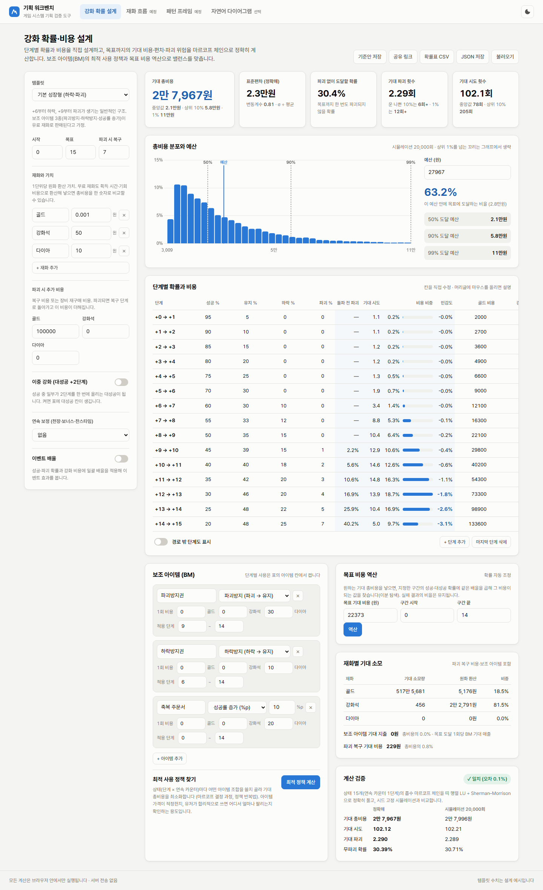
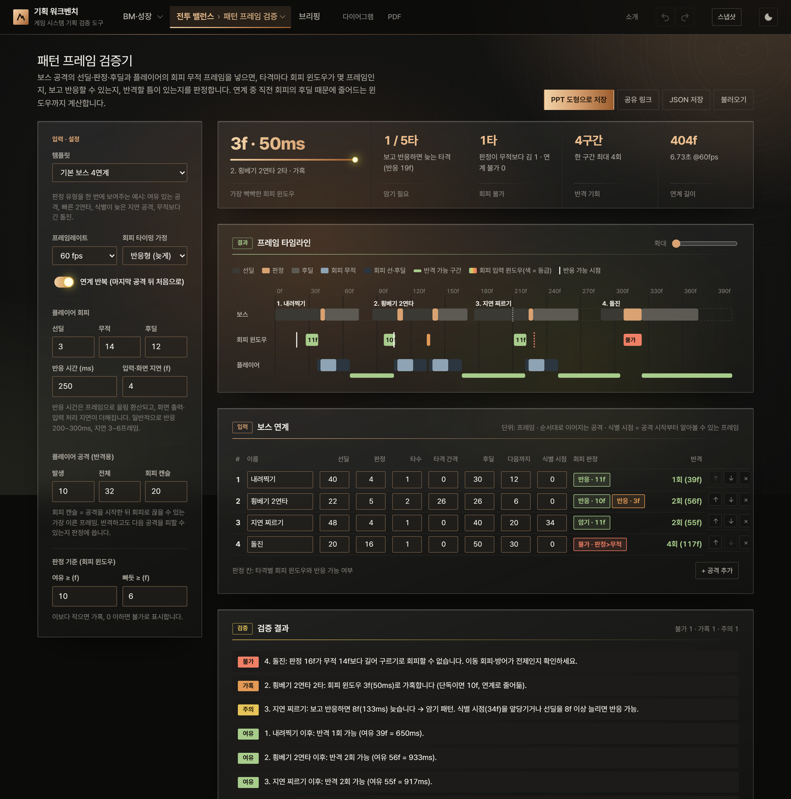

# 기획 워크벤치

게임 시스템 기획자가 **엑셀로 풀기 어려운 검증**을 브라우저에서 바로 돌려보는 도구 모음입니다.

**▶ 데모: https://junhy96.github.io/gamedesign_workbench/**



**▶ 기획 판단 사례: [docs/case-study.md](docs/case-study.md)** — 이 도구들로 실제로 어떤 결정을 내리는지 (가챠 목표 비용, 강화 아이템 가격, 콘텐츠 해금과 잔존)

### 핵심 검증 도구

| 도구 | 무엇을 하나 | 상태 |
|---|---|---|
| 강화 확률·비용 설계 | 기획자가 확률·비용·BM 아이템(수량형 포함)을 설계 → 기대 비용, 편차, 파괴 위험, 최적 아이템 사용, **아이템 가격 곡선**, 목표 비용 역산, **단계별 기대 소모를 재화 흐름으로 보내기** | ✅ 완료 |
| 가챠·수집 설계 | 등급 확률·소환 레벨·천장(확률 상승)·픽업 보장·마일리지·중복 분해 교환 → 수집 목표(K종 × k장)·픽업 k장·**같은 등급의 특정 캐릭터 k장**의 기대 비용과 분포, **확률 공시표(모든 캐릭터 확률·천장 변동표·실효 확률·조건 문장, CSV)**, 예산별 달성 확률, **단순 계산 → 확률 구조 → 중복**으로 나눈 비용 원인, 무과금·과금 유저 도달 기간 | ✅ 완료 |
| 패턴 프레임 검증기 | 보스 연계의 선딜·판정·후딜 + 회피 무적 → 타격별 회피 윈도우, 반응/암기 판정, 선입력 강제 구간, 반격 여유 | ✅ 완료 |
| 성장 재화 수급 설계 | 공급원(콘텐츠·상품의 획득량 × 세그먼트별 횟수 × 주기·해금일)과 성장 목표(마일스톤: 기준 세그먼트가 n일차에 Lv m) → 공급에 맞춘 레벨별 필요량 역산, 단조 증가 보정·반올림, 마일스톤 사이 직선/단조 3차 곡선 연결, 세그먼트별 레벨 도달일, 등비 근사, **필요량 표를 재화 흐름 시뮬레이터 성장 항목으로 바로 보내기** | 🧪 초안 |
| 방치형 스테이지 성장 | 챕터-스테이지별 몬스터 체력·웨이브 골드 + 골드 강화 **구간 비용 공식**(LV_MIN~LV_MAX, 시작 비용 + 증가폭, 마지막 구간 끝 없음) → 돌파 필요 레벨, **실제 체류 vs 의도 체류** 그래프, 정체 스테이지와 **반대 가정으로 확인한 원인**, **민감도(토네이도)·해소에 필요한 최소 변경**, 구간 표 편집·**CSV 붙여넣기/파일 가져오기**(열 이름 매핑), 만·억·조·경/지수 표시 | 🧪 초안 |
| 스탯·전투 밸런스 | 엔티티 × 사용자 정의 스탯(선형·등비·표 보간 성장) × 아이템 수정자(고정·%·배율, 순서 무관) × **코드 실행 없는 규칙 수식**(데미지·명중·치명·공격 속도·체력·CP) → 레벨 곡선(CP·초당 데미지·처치 시간)과 **역전 레벨**, **1:1 승률 정확해**(시간 기반: 공격 속도 = 초당 공격 / 턴 교대: Kalivra 방식), 승률 행렬(시뮬레이션 칸은 Wilson 95% 구간), **CP 순위와 실제 승률이 어긋나는 쌍**, **특성(트리거 8종 × 조건 × 효과 5종)**·전투 로그·발동 통계, **구간 리포트**(레벨 구간별 평균 승률·지배·상성 순환), **밸런스 도구**(점수 목표 최소 변경·민감도 토네이도·아이템/특성 효과 분해·CP/점수 목표 역산), 기준안 비교, **Kalivra 프로젝트(.kal) 가져오기**(특성 포함), CSV, **Unity·Unreal 내보내기**(규칙 수식 → C#·C++ 코드) | 🧪 초안 |
| 브리핑 | 모든 탭의 핵심 지표와 검증 문장을 한 장으로: 기준 스냅샷 대비 변화, 지표마다 목표(≤·≥) → **통과·미달**, 결론·근거·리스크·결정 요청 메모, **PDF로 저장(인쇄)** | 🧪 초안 |
| 재화 흐름 시뮬레이터 | RPG 성장 루프(콘텐츠 → 재화 → 성장 → 전투력 → 보상·해금) 일 단위 시뮬레이션. 세그먼트는 플레이 시간·접속 횟수·월 과금·스태미나 충전·**D1/D7/D30 잔존율**로 정의. 성장 곡선과 **유저 편차 띠(하위·상위 10%)**, **콘텐츠 해금일의 잔존율·설치당 매출(LTV)**, 병목 재화, 정체·적체·격차 경고, 흐름 분해, **성장 루프 다이어그램(선 교차를 줄인 열 배치, 노드는 종류별·선은 재화별 색)** | 🧪 초안 |

### 부가 도구

| 도구 | 무엇을 하나 |
|---|---|
| 자연어 다이어그램 | 문장 → Mermaid 다이어그램(Claude API), 코드 편집·미리보기, SVG·PNG·**PPT 도형** 내보내기. 블록 종류 자동 분류·색, 아니오 분기 빨간 선, 시퀀스 참여자별 색, 범례(INDEX) 자동 생성 |
| PDF 도구 ([/pdf](pdf/)) | 합치기·분할·압축·PDF↔JPG·워터마크·서명 등 13종, **파일 업로드 없이 브라우저 안에서만 처리** ([참고 분석](docs/pdf-reference-analysis.md)) |

**되돌리기 (전 탭 공통)**: 헤더의 ↶ ↷ 또는 Ctrl+Z · Ctrl+Shift+Z(입력칸 밖에서). 탭이 설정을 저장할 때마다 한 단계(입력 0.3초 묶음), 탭마다 최대 50단계, 창을 닫으면 사라짐. 각 탭이 이미 가진 공유 링크 불러오기 경로로 되돌리므로 모든 탭에서 같은 방식으로 동작합니다.

**스냅샷 (전 탭 공통)**: 헤더의 "스냅샷"에서 모든 탭(강화·가챠·수급·스테이지·스탯 전투·재화 흐름·프레임)의 지금 설정을 한 번에 저장하고, 나중에 지금 설정과 **탭별 핵심 지표를 비교**(바뀐 탭 표시, 지표마다 변화와 좋아짐·나빠짐 색)하거나 되돌립니다. 프로젝트 파일(JSON)로 저장·불러오기 하면 팀과 같은 설정을 나눌 수 있습니다.

**PowerPoint 내보내기**: 패턴 프레임 타임라인, 자연어 다이어그램(Mermaid), 재화 흐름의 성장 루프를 PowerPoint에서 바로 편집할 수 있는 기본 도형(사각형·마름모·선·화살표·텍스트 상자)으로 저장합니다. SVG를 그림으로 붙이는 방식이 아니라, 화면의 SVG 요소를 하나씩 읽어 도형으로 바꿉니다.
패턴 프레임 검증은 전투 기획서 '기술 일람' 양식(보라 헤더 바 · 정보 표 · 행 라벨 표 위 초 단위 축과 둥근 막대, 프리젠테이션 글꼴)으로 만듭니다: 패턴 타임라인 → 공격별 1장(공격 구간 확대, 0초 = 공격 시작) → 패턴별 판정 표 → 검증 결과. 애니메이션 띠는 캡처를 붙여 넣는 자리로 비워 둡니다.

전체 기획과 설계 결정은 [docs/PLAN.md](docs/PLAN.md)에 정리했습니다.

---

## 강화 확률·비용 설계

강화 시스템의 **BM과 밸런스를 설계하는 기획자용 도구**입니다. 특정 게임의 확률을 계산하는 것이 아니라, 기획자가 단계별 확률과 비용을 직접 넣고 조정하면서 기대값이 어떻게 바뀌는지 바로 확인합니다.
실패 시 하락·파괴·천장 같은 규칙이 섞이면 엑셀로는 정확한 기대값을 구하기 어렵습니다. 이 도구는 이를 **흡수 마르코프 체인**으로 모델링해 정확히 풉니다.

### 설계할 수 있는 것
| 항목 | 내용 |
|---|---|
| 단계별 확률 | 성공(+1) · **대성공(+2, 이중 강화)** · 유지 · 하락 · 파괴 |
| 비용 | 재화 최대 4종(골드·재료·유료 재화 등), 재화별 원화 환산 가치 |
| 파괴 | 복구 단계 + 복구 비용(재화별) |
| 연속 보정 | **천장**(N회 연속 실패 시 확정 성공), **실패 누적 보너스**(실패할수록 성공률 상승, %p 또는 기본 성공률 대비 %), **찬스타임**(연속 하락 기준) |
| 보조 아이템(BM) | 파괴방지 · 하락방지 · 성공률 증가 — 가격(재화별)과 적용 단계 범위. 성공률 증가는 **수량형**(개당 +%p, 한 번에 최대 n개)도 가능해 단계 표에서 투입 개수를 넣음 |
| 이벤트 | 성공·파괴 확률과 비용에 일괄 배율 |

### 결과
- **기대 총비용**(원화 환산), **정확한 표준편차**, 파괴 없이 도달할 확률, 기대 파괴 횟수(운 나쁜 10%·1%), 기대 시도 횟수
- 재화별 기대 소모량, **보조 아이템 기대 지출(= 목표 도달 1회당 BM 기대 매출)**, 파괴 복구 비용
- 총비용 분포와 **예산별 도달 확률** (예: “3만 원 안에 +15에 도달하는 유저 비율”)
- **강화 경로 예시**: 시뮬레이션 앞 12번 시행의 시도별 단계 — 시도 횟수가 중간인 시행과 가장 오래 걸린 시행을 강조하고 그 두 시행의 파괴 지점을 표시
- **시뮬레이션 수렴**(계산 검증 카드): 시뮬레이션 횟수(로그 축)에 따른 누적 평균 총비용과 95% 범위, 공식 계산값 점선
- **달성 분위별 수치**: 총비용·시도·파괴를 0.1% · 1% · 5% · 10% · 25% · 50% · 75% · 90% · 95% · 99% · 99.9%로 (“1,000명 중 가장 운 나쁜 1명은 파괴 18회”), 막대 그래프(평균 점선) + 표. 평균은 정확해, 분위는 시뮬레이션이라 바깥 분위가 표본 몇 개로 정해지는지 함께 표시
- 단계별: 돌파 전 파괴 확률(하락 경로 포함 정확해), 기대 시도, 비용 비중, **민감도**(성공률 +1%p당 기대 비용 변화)

### 밸런싱 도구
- **보조 아이템 최적 사용 정책** — 상태(단계 × 연속 카운터)마다 아이템 조합(수량형은 투입 개수까지)을 골라 기대 총비용을 최소화하는 정책을 **마르코프 결정 과정의 정책 반복법**으로 찾습니다. 아이템 가격이 적정한지, 합리적인 유저가 어느 단계에서 얼마나 쓰는지 확인할 수 있습니다.
- **아이템 가격 곡선** — 한 아이템의 가격을 범위로 바꿔 가며 최적 정책을 다시 풀고, 가격별 **BM 기대 매출**과 **유저 절감률**(아이템 없이 대비)을 그래프 두 개로 보여 줍니다. 매출이 최대가 되는 가격과 절감률이 목표 이하로 떨어지는 가격을 찾고, 없으면 이유(예: “240 다이아부터 이 아이템은 안 쓰이고 나머지 아이템만으로 39.8% 절감 — 다른 아이템 가격도 올려야 함”)를 알려 줍니다. 찾은 가격은 버튼 한 번으로 적용합니다.
- **목표 비용 역산** — 원하는 기대 총비용을 넣으면 지정 구간의 성공률 배율을 이분 탐색으로 찾아 표에 적용합니다.
- **기준안 비교** — 현재 결과를 기준안으로 저장하고, 수정할 때마다 모든 지표의 변화율을 확인합니다.
- **확률표 CSV** — 이벤트를 반영한 실효 확률표를 내보내 확률 공시 검토에 사용합니다.
- **재화 흐름으로 보내기** — 단계별 재화 기대 소모(방문 횟수 × 시도 비용, 하락 후 재도전·파괴 복구·보조 아이템 포함)를 재화 흐름 시뮬레이터의 성장 항목 비용 표로 넣습니다. 단계 합은 재화별 총 기대 소모와 정확히 같습니다.

### 계산 방법
- 상태 = (단계, 연속 카운터). 상태별 기대 비용 `E`는 `(I − P)E = r`을 만족합니다.
- 상태를 단계 순으로 정렬하면 `I − P`는 **띠 행렬 + 파괴로 인한 한 열(rank-1)** 입니다. 띠 부분은 피벗 없는 띠 LU로 분해하고(행 대각 우세라 안정), 파괴 열은 **Sherman–Morrison 공식**으로 보정합니다. 천장 수십 회 × 단계 수십 개(상태 수천 개)도 즉시 풉니다.
- 같은 분해 하나로 구하는 값들:
  - 기대 비용·시도·파괴, 재화별 소모량 (우변만 바꿔 풀기)
  - **2차 모멘트** `S = Σ P(w² + 2wE) + PS` → 정확한 분산
  - 전치 시스템으로 **상태별 방문 횟수** → 단계별 분해와 **수반(adjoint) 방법 민감도**
  - 파괴 없이 도달할 확률, 파괴 횟수 분포(기하분포)
  - 단계별 돌파 전 파괴 확률: 피벗 없는 LU에서 선행 주부분행렬의 LU는 LU의 선행 블록이므로, 추가 분해 없이 앞부분만 풀어 구합니다.
- 아이템 최적화의 행동은 단계마다 (토글형 0/1개 × 수량형 0~최대 개수) 조합입니다. 실효 확률은 (파괴방지 여부, 하락방지 여부, 성공률 증가 합)만으로 정해지므로 효과가 같은 조합은 가장 싼 것 하나로 합칩니다 — 예: 상급 0~8 × 중급 0~15 × 하급 0~50 = 7,344 조합 → 521가지.
- 분포는 시드 고정 몬테카를로 2만 회를 Web Worker에서 돌립니다.

### 검증 (`npm test` 중 23개)
- 정확해 = **체인과 독립적으로 게임 규칙을 그대로 구현한 시뮬레이터** (하락·파괴, 아이템, 천장+보너스, 이중 강화+찬스타임, 이벤트 각각)
- 띠 행렬 + Sherman–Morrison 풀이 = 밀집 행렬 가우스 소거 (오차 1e-8)
- 해석해: 1단계 성공 확률 p → 평균 1/p, 분산 (1−p)/p²
- 수반 방법 민감도 ≈ 유한 차분, 최적 정책 ≤ 수동 조합들, 역산 결과가 목표 비용과 일치
- 단계별 재화 기대 소모의 합 = 재화별 총 기대 소모
- 수량형·가격 곡선: [docs/samples/enhance-quantity-items.json](docs/samples/enhance-quantity-items.json)을 불러와 아이템 없이 기대 비용, 최적 정책(기대 비용·BM 지출·단계별 투입 개수), 가격 곡선 30개 점과 매출 최대 가격이 **단계별 투입량 전수 탐색으로 따로 구한 정답**과 일치. 수량형 n개 = 효과·가격 n배 토글형, 수량형 + 하락·파괴도 규칙 시뮬레이터와 일치, 저장 형식 v2 → v3 마이그레이션

화면의 “계산 검증” 카드에서도 정확해와 시뮬레이션을 실시간으로 비교합니다.

---

## 가챠·수집 설계

수집형·방치형 게임의 뽑기를 **"이 유닛을 이만큼 모으려면 얼마가 드나"**로 설계하는 도구입니다.
기획서에서 흔히 쓰는 `필요 장수 ÷ 확률`은 두 가지를 놓칩니다. 소환 레벨처럼 **확률이 처음엔 낮은 구간**과, 이미 다 모은 유닛이 또 나오는 **중복**입니다. 이 도구는 둘을 따로 계산해 보여줍니다.

### 설계할 수 있는 것
| 항목 | 내용 |
|---|---|
| 등급 | 확률·종 수, 중복 1장이 바뀌는 조각 수, 그 등급 원하는 1장의 조각 교환 가격 |
| 소환 레벨 | 누적 뽑기 수 기준으로 바뀌는 등급별 확률표 (방치형의 "소환 레벨") |
| 천장 (최상위) | 확정 천장 + 확률 상승 시작·회당 상승폭 |
| 픽업 (최상위) | 픽업 비율, 놓치면 다음 최상위 픽업 확정 |
| 마일리지 | 뽑기당 적립, 교환 가격 → 최상위 원하는 1장 |
| 목표 | 수집(등급의 K종을 각 k장) / 픽업 유닛 k장 / 특정 캐릭터 k장(픽업 등급이면 픽업이 아닌 캐릭터) |
| 캐릭터 이름 | 등급마다 쉼표로 구분 (공시표에 표시, 비우면 '등급 n') |
| 기준 유저 | 무과금 하루 획득량, 월 과금액 → 도달 기간 |

### 결과
- 목표별 기대 뽑기·비용(원), 50/90/99% 달성 비용, **단순 계산 대비 배수**, 무과금·과금 유저 도달 일수
- 달성 확률 곡선과 **예산 → 달성 확률**
- **시뮬레이션 수렴**(계산 검증 카드): 고른 목표의 누적 평균 뽑기 수와 95% 범위, 공식 계산값이 있으면 점선 — 시뮬레이션 횟수를 정할 때 참고
- **달성 분위별 수치**: 뽑기·비용·무과금 도달일·**천장 구간 당첨**(확률 상승 구간이나 확정 천장에서 최상위가 나온 횟수)을 0.1% ~ 99.9%로, 막대 그래프 + 표. 정확해가 있는 목표는 뽑기 분위도 정확한 분포에서
- **왜 이만큼 드나**: ① 단순 계산 → ② 중복이 없다면(확률 구조·천장·교환 효과) → ③ 실제(중복 효과), 획득 경로(직접·천장·마일리지·교환) 비중
- **확률 공시표**: 확률형 아이템 공시용으로 소환 레벨별 ① 등급 확률 ② **모든 캐릭터의 개별 확률**(같은 등급 균등, 픽업 등급은 픽업 비율로 분할)과 캐릭터마다 처음부터 1장을 얻는 기대 뽑기·비용 ③ 천장 확률 변동표(마지막 최상위 이후 n번째 확률과 누적 확률) ④ 천장·보장을 포함한 실효 확률 ⑤ 확률이 바뀌는 조건 문장(소환 레벨·천장·픽업 보장·마일리지·조각 교환). 표시 자릿수(2~6)로 반올림했을 때 0%로 보이는 캐릭터와 합계 오차를 경고하고, CSV(소수 6자리 이상)로 내보냅니다.
- 검증 문장: 중복·확률 구조로 몇 % 더 드는지, 운 나쁜 1%가 평균의 몇 배인지, 과금 유저도 1년을 넘는 목표, 교환·천장이 비용을 정하는 목표

### 계산 방법
- **시뮬레이션**: 목표 등급의 다음 당첨까지를 기하분포로 한 번에 건너뜁니다. 확률이 바뀌는 지점(소환 레벨 경계, 천장 확률 상승 구간, 마일리지·조각이 교환 가격에 닿는 시점)에서만 끊으므로 0.005% 확률로 수십만 회를 뽑는 목표도 즉시 계산됩니다. 다른 등급의 중복 조각은 뽑기당 기대값으로 쌓습니다.
- **정확해 ① 수집** (확률 고정·교환 없음): 포아송화. 시행 횟수의 기댓값은 연속 시간 포아송 과정에서 완료 시각의 기댓값과 같으므로
  `E[N] = (1/λ) ∫₀^∞ 1 − P(k, u)^K du` (λ = 등급 확률 ÷ 종 수, P = 정칙화 하부 불완전 감마). 심프슨 적분.
- **정확해 ② 픽업·특정 캐릭터** (그 등급 분해 교환 없음): 상태(모은 장수, 천장 카운터, 보장 여부)의 확률 분포를 뽑기마다 전진시키는 동적 계획법. 소환 레벨과 마일리지(뽑기 수만으로 정해지는 시점에 1장 추가)도 그대로 반영되고, 분포 전체(분위수·예산별 달성 확률)가 정확합니다. 픽업이 아닌 특정 캐릭터는 보장 상태에서 나올 수 없다는 전이까지 반영합니다.
- **실효 확률**: 최상위 한 장당 평균 뽑기 수 `Σ_j Π_{i<j}(1 − p_i)`의 역수(p_i = 마지막 최상위 이후 i번째 확률). 픽업은 보장이 있으면 최상위 `2 − s`장당 1장.
- 정확해가 있는 목표는 화면의 "계산 검증" 카드에서 시뮬레이션과 실시간 비교합니다.

### 검증 (`npm test` 중 22개)
- 쿠폰 수집 n종 = `n·Hₙ / p`, 1종 k장 = 음이항 평균 `k / λ` (정확해 ①, 오차 1e-6)
- 정확해 ① = 시뮬레이션, 정확해 ②(천장·확률 상승·보장·마일리지) = 시뮬레이션 (평균·90% 분위)
- 천장: 픽업 100%면 천장 횟수 안에 반드시 달성, 평균 = 절단 기하분포 `(1 − (1−p)^N) / p`
- 마일리지만 있을 때 = 교환 주기 × 장수, 소환 레벨 경계 이전엔 당첨 불가, 조각 교환이 기대 뽑기를 줄임
- 정칙화 감마 `P(1, x) = 1 − e^−x`, 확률 합·종 수·픽업 등급 검증
- 특정 캐릭터(픽업 아님, 보장 있음) = 해석해 `(2 − s − q) / (q·p)` = 시뮬레이션, 보장 없으면 `1 / (p·q)`
- 공시표: 레벨마다 캐릭터 확률 합 100%·캐릭터 합 = 등급 확률, 천장 변동표 마지막 줄 100%, 실효 확률(확정 천장만이면 절단 기하분포)

---

## 방치형 스테이지 성장

방치형 게임은 성장을 **"챕터-스테이지 기준 드랍, 구간별 강화 비용, 의도 체류 시간"**으로 설계합니다. 레벨이 수십만까지 가고 시간 단위가 '일'이 아니라 '스테이지에 머무는 초·분'이라, 일 단위·레벨 수십 개를 전제로 한 수급·재화 흐름 탭으로는 다루기 어렵습니다.
이 도구는 레벨별 표 대신 **비용 구간 공식**만으로 스테이지마다 실제로 얼마나 머무는지 계산하고, 기획 의도와 어긋나는 구간을 찾아 그 원인이 된 비용 구간을 짚습니다.

### 설계할 수 있는 것
| 항목 | 내용 |
|---|---|
| 구조 | 챕터 수 × 챕터당 스테이지 |
| 몬스터·웨이브 | 첫 체력·스테이지당 증가율(%, 0.01%p 단위), 웨이브당 몬스터, 웨이브 제한 시간·웨이브 시간, 돌파 웨이브 수 |
| 골드·공격력 | 첫 웨이브 골드·스테이지당 증가율(%), 기본 공격력·레벨당 공격력 |
| 강화 비용 구간 | `LV_MIN, LV_MAX, INIT_COST, STEP` — 구간 안에서 L → L+1 비용 = `INIT_COST + STEP × (L − LV_MIN)`, 마지막 구간 LV_MAX 비움 = 끝 없음. 구간 추가·삭제(경계 자동 연결), "시작 비용 이어 붙이기" |
| 의도 체류 | 1챕터 스테이지당 초 × 챕터마다 배수, 정체 기준(의도의 n배 초과) |

### 결과
- 총 소요 시간과 의도 대비 배수, 정체 스테이지 수, 최종 필요 레벨·누적 강화 골드, 가장 오래 머무는 스테이지
- 그래프 3종: **스테이지별 실제 체류 vs 의도 체류**(정체 기준선, 정체 = 빨간 점) / 누적 시간 / 필요 레벨과 비용 구간 경계 (로그 축)
- 구간 표 계산 칸: 끝 1레벨 비용, 구간 합계, 경계 비용이 끊기는지, **이 구간 레벨을 요구하는 스테이지와 정체 수**
- 챕터별 체류 표 (누르면 스테이지별로 펼침)
- 검증 문장: 챕터별 정체, **원인 구간**(반대 가정 — 그 구간 증가폭을 이웃 수준으로, 끊겨 올라간 시작 비용을 이어 붙였을 때 정체가 절반 이상 풀리면 원인, 일부만 풀리면 '다른 변수 영향이 큼', 어느 구간도 아니면 '전체 변수 탓'), 원인 경고의 **적용** 버튼, 경계 비용 끊김, 끝 있는 마지막 구간을 넘는 레벨, 너무 빨리 지나가는 스테이지
- **정체 원인 · 민감도** 카드
  - 해소에 필요한 최소 변경: 변수 하나만 움직여 대상 정체(2곳 이상 몰린 챕터의 정체)를 모두 푸는 값과 그때의 총 소요·남는 정체, 필요한 변화가 작은 순. 버튼으로 적용. 샘플에서는 체력 증가율 4% → 3.966%(−0.85%)로 풀리고, 문제 구간 증가폭은 30 → 25.98(−13.4%)이 필요 — 정체를 좌우하는 것은 구간보다 성장률 비율
  - 민감도(토네이도): 변수마다 ±5/10/20% → 총 소요 변화와 정체 수. 증가율은 증가분 기준(4% → 4.4%), 막대 길이는 로그 배율, 표로 보기
- 큰 수 표시: 만·억·조·경 두 단위(25억 7,633만) 또는 지수(2.58e9), 1해 이상은 지수
- 저장: JSON 저장/불러오기(머리 정보 + `state`, [샘플](docs/samples/stage-idle-growth.json)을 그대로 불러올 수 있음), 공유 링크, 구간 CSV 내보내기, 스테이지별 결과 CSV
- **스탯·전투에서 가져오기**: 그 탭의 플레이어 공격력 곡선을 직선(기본 공격력·레벨당 공격력, 강화 레벨 L = 전투 Lv L + 1)으로, 몬스터 체력 곡선을 등비(첫 체력·스테이지당 증가율, 스테이지 s = 전투 Lv 1 + (s − 1) × 스테이지당 레벨)로 맞춰 옮김. 맞춘 오차와 "등비가 아니라 근사함", "전투 탭 최대 레벨 뒤는 같은 비율로 이어짐" 안내

### 계산 방법
- 필요 레벨 `L_req(s)` = 공격력 × 웨이브 제한 시간 ≥ 몬스터 수 × 체력이 되는 최소 정수 레벨
- 누적 비용(0 → L)은 구간마다 등차수열 합 `n × INIT_COST + STEP × n(n−1)/2`이라 레벨이 수십만이어도 즉시 계산
- 실제 체류(s) = max(누적비용(L_req(s)) − 누적비용(L_req(s−1)) ÷ 앞 스테이지의 초당 골드, 돌파 웨이브 수 × 웨이브 시간)
- 정체 = 실제 체류 > 정체 기준 × 의도 체류. 정체 스테이지가 올리는 레벨 범위 `[L_req(s−1), L_req(s))`와 겹치는 비용 구간을 반대 가정 대상으로 묶음
- 원인·민감도는 설정을 하나씩 바꿔 전체를 다시 계산(총 소요·정체만 구하는 가벼운 경로). 증가폭 숫자끼리 비교하지 않는 이유: 구간마다 시작 비용과 레벨 규모가 달라 숫자 크기가 영향 크기를 말해 주지 않음
- 최소 변경: 값의 로그 스케일 이분 탐색(최대 100배·1/100, 30회), 유효 숫자 4자리로 정체가 다시 생기지 않는 쪽 반올림. 웨이브 시간은 골드 속도와 돌파 시간을 같이 바꿔 방향이 정해지지 않으므로 민감도에만 표시
- CSV 가져오기: 구분자 자동(쉼표·탭·세미콜론), 천 단위 쉼표·따옴표 칸 허용, 열 이름 별칭(`LV_MIN`/`시작레벨`/`from` …)으로 자동 매핑하고 화면에서 직접 바꿀 수 있음. 머리글이 숫자뿐이면 열 순서대로, LV_MAX 열이 없으면 다음 줄 LV_MIN으로 채움

### 검증 (`npm test` 중 20개)
- [샘플 JSON](docs/samples/stage-idle-growth.json)을 불러와 `expected`와 일치: 누적 비용(Lv1,000 / 1만 / 10만), 체크포인트 5곳(필요 레벨·필요 골드·실제/의도 체류·누적 시간), 총 78.41시간, 정체 스테이지 8곳
- 누적 비용 공식 = 0~150,000레벨 직접 합산 (끝 없는 구간 포함)
- 경고가 16~17챕터 정체와 5,000~20,000 구간(증가폭 30, 앞뒤 8·15)을 원인으로 잡고, 그 증가폭을 8로 낮추면 정체가 사라짐. 경고의 반대 가정을 실제로 적용해 다시 계산하면 말한 7곳이 모두 풀림
- 빈 템플릿처럼 구간 탓이 아닌 정체는 '전체 변수' 경고
- 가벼운 경로 = 전체 계산(총 소요·정체 스테이지), 민감도 ±10% = 그 값으로 다시 계산한 총 소요, 증가율 4% → 3.6%/4.4%
- 최소 변경: 적용하면 대상 정체가 모두 풀리고, 변화량의 절반만 적용하면 남음(모든 레버)
- [CSV 샘플](docs/samples/stage-cost-intervals.csv) = JSON의 구간 표(빈 LV_MAX = 끝 없음), 탭·한글 머리글·열 순서·머리글 없음·LV_MAX 열 없음·끊긴 구간 오류
- 큰 수·시간 표시
- 스탯·전투에서 가져오기: 선형 공격력·등비 체력은 정확히 옮겨짐, 스테이지당 레벨 2면 증가율 제곱, 선형 체력은 등비 근사 + 안내

---

## 스탯·전투 밸런스

턴제·자동 전투 게임의 캐릭터 스탯과 성장 곡선을 **"레벨마다 누가 누구를 몇 % 이기나"**로 검증하는 도구입니다. 밸런스 툴 [Kalivra](https://github.com/DevBawky/Kalivra)(Bawky)의 문제 정의(엔티티 × 스탯 × 수식 × 승률)를 참고했고, 계산은 이 저장소 방식으로 새로 만들었습니다(코드는 가져오지 않음). 분석 기록: [docs/kalivra-analysis.md](docs/kalivra-analysis.md)

### 설계할 수 있는 것
| 항목 | 내용 |
|---|---|
| 스탯 | 이름(수식용)·설명·최소·최대, 성장 방식 선형 `b + g·(Lv−1)` / 등비 `b·(1+g%)^(Lv−1)`, 칸마다 "표"(레벨:값, 사이 직선 보간 = 구간 성장) |
| 엔티티 | 스탯별 기본값·성장값, 데미지 변동(±비율), 일괄 편집(선택한 엔티티의 기본값·성장값을 ×·+·=), CSV 붙여넣기 |
| 아이템 | 대상(전체·엔티티) + 수정자: 스탯 = (값 + Σ고정) × (1 + Σ%) × Π배율 — 아이템 순서와 무관 |
| CP | Combat Power(전투력). 스탯을 CP 수식으로 합친 숫자 하나로, 게임 화면의 "전투력"에 해당합니다. 승패 계산에는 쓰지 않고, CP 순서가 실제 1:1 승률 순서와 맞는지 비교하는 데 씁니다 |
| 규칙 수식 | 데미지·명중(%)·치명 확률(%)·치명 배율 = 공격 쪽 `a.스탯`, 맞는 쪽 `b.스탯` / 체력·공격 속도·CP = 자기 스탯. `min max clamp floor …`, 조건 `? :`, `lv`. 수식 프리셋(방어 감쇠형·차감형 등) |
| 전투 방식 | **시간 기반**(n번째 공격 시각 = (n−1) ÷ 공격 속도, 동시 결정타 = 동전/무승부, 최대 시간) / **턴 교대**(Kalivra와 같음: 공격 속도 비율로 선공, 번갈아 공격, 최대 턴). 명중 하한·상한, 데미지 반올림 |
| 특성 | 엔티티·아이템에 붙임(아이템 특성은 대상에게). 발동 시점 8종(전투 시작·매 턴/1초·공격 직전·적중·치명타·빗나감·회피·피격) × 확률 × 체력 조건(나/상대 ≤ %) × 최대 발동, 효과 5종(회복·추가 데미지 = 고정/이번 데미지 %/최대 체력 %, 이번 공격 데미지 ×·+, 스탯 버프 = 고정/기본값 %·지속). 프리셋 8종(흡혈·가시·광폭화·선제 방어·분노 일격·처형·재생·반격) |
| 구간 | 구간 경계(예: 10, 20 → Lv1~10·11~20·21~끝), 비우면 1/3·2/3 |

### 결과
- KPI: 기준 레벨의 가장 강한 엔티티(상대 평균 승률), CP와 실제 강함의 순위 상관, CP가 높은데 지는 쌍, 계산 방식(정확해/시뮬레이션)
- 레벨 곡선: CP·초당 기대 데미지·처치 시간(기준 상대), 역전 레벨(세로 점선·목록), 기준안 점선
- 승률 행렬: 한 쌍은 한 번만 계산(A 대 B 승 = B 대 A 패), 승(파랑)·패(주황) 발산 색, 시뮬레이션 칸은 ±95% 구간과 50%를 걸치면 흐리게, 기준안 대비 ▲▼%p, 칸을 누르면 1:1 상세
- 1:1 상세: 승·무·패, 두 방향의 명중·치명·1회 데미지·공격 속도·체력, 쓰러뜨리는 공격 수(평균·중앙값·운 나쁜 1%·시간 안에 못 쓰러뜨릴 확률), 정확해 대 시뮬레이션 검증(실현 명중·치명률 포함), 레벨별 승률 곡선
- 1:1 상세(계속): **시뮬레이션 수렴**(승률 누적값과 95% 범위, ±1%p 안으로 들어온 횟수), **전투 길이 분포**(이긴 쪽별로 쌓은 막대), 특성별 전투 한 번 평균 발동 횟수, **전투 로그 20전투** + 고른 전투의 **체력 타임라인**(두 엔티티 체력 계단선, 치명타 ▲, 드문 특성 발동 ◆)
- **구간 리포트**: 레벨마다 행렬을 계산해 엔티티별 상대 평균 승률 곡선(구간은 회색 띠)과 구간 평균 표, 구간 지배(평균으로 모든 상대에게 55% 이상), 모든 구간 같은 1위(2위보다 5%p 이상 앞설 때), 구간 사이 승률 변화 25%p 이상(초반형·후반형 확인). 시뮬레이션 쌍은 계산 예산 안에서 반복 수를 줄이고 레벨을 나눠 비동기로 계산
- **밸런스 도구** (대상·상대(한 명 또는 모든 상대 평균)·레벨, 점수 = 승 + 무/2)
  - 점수를 목표(기본 50%)로 만드는 최소 변경: 스탯 하나를 ×k(기본값·성장값·표 모두) — 필요한 배율이 작은 순, 적용 버튼. 정수 공격 횟수 때문에 점수가 계단 모양이라 목표를 처음 넘는 배율과 그때 점수를 보여 줌. 상한에 막힌 스탯은 "닿지 않음"
  - 민감도 토네이도: 대상과 상대의 스탯마다 ±5/10/20% → 점수 변화(%p)
  - 아이템·특성 효과 분해: 하나씩 끄면 점수가 얼마나 바뀌나
  - 목표 역산: CP·초당 데미지·점수를 목표로 성장값·기본값·전체 배율을 찾음 (Kalivra의 "Lv20 CP = 1000 → 성장값"을 점수 목표까지)
  - 시뮬레이션이 필요한 쌍은 같은 시드(공통 난수)로 계산해 설정 차이에 따른 잡음을 줄이고, 버튼을 눌렀을 때 단계로 나눠 계산
- 검증: 실제 순위 대 CP 순위 표, CP 역전 쌍, 순위 상관 낮음, 모든 상대에게 55% 이상(지배), **상성 순환**(A > B > C > A, 55% 이상), 무승부 20% 이상, 첫 공격에 쓰러뜨릴 확률 50% 이상, 역전 레벨, 특성 설정 경고(공격 직전·피격이 아닌 곳의 데미지 ×·+ 등)
- 저장: JSON·공유 링크, 레벨별 스탯 CSV, 승률 행렬 CSV, 엔티티 표 CSV
- **아이템 세트(빌드)**: 지금 아이템 목록(켜기·대상·수정자·특성)을 이름 붙여 저장·적용, 빌드마다 엔티티 평균 승률을 한 표로 비교(지금 대비 %p)
- **엔진 내보내기** (zip, 외부 라이브러리 없이 만듦)
  - Unity: `BattleData.json`(ID는 문자열, 표는 { lv, value } 목록 — JsonUtility가 읽는 형식), ScriptableObject(`BattleEntitySO.StatsAt` = 이 탭과 같은 성장·수정자 공식), 에디터 메뉴 `Tools > Planning Workbench > Import Battle Data`, 규칙 수식을 옮긴 `BattleRules.cs`
  - Unreal: DataTable이 바로 읽는 행 배열 JSON(Name = ID)·CSV, 행 구조체 `BattleRows.h`(스탯마다 Base·Growth·Table 열, 한글 스탯 이름은 Stat1 …로), 규칙 수식 `BattleRules.h`
  - 수식 → 코드: 같은 파서 결과를 C#·C++로. 참·거짓 1·0, `round`는 JS와 같은 반올림(C# Mathf.Round는 짝수 반올림이라 쓰지 않음), C++ min·max는 두 개씩 중첩, %는 FMath::Fmod
  - Kalivra 내보내기와 다른 점: ID 문자열(Kalivra는 Date.now() 숫자를 C# int로 받아 넘침), 특성의 트리거·효과 전부(Kalivra는 첫 번째만), Unreal은 행 배열·구조체까지

### 계산 방법
- 한 번의 공격 = 빗나감(1 − h) / 일반 h(1 − c) / 치명 hc. 쓰러뜨릴 때까지의 공격 횟수 N의 분포를 (일반 적중 수, 치명 수) 상태를 공격마다 전진시키는 동적 계획법으로 정확히 구한다(데미지 반올림 포함).
- 트리거·버프가 없으면 두 엔티티의 N은 서로 독립 → 시간 기반 `P(A 승) = Σₙ P(N_A = n) · P(B가 (n−1)/s_A 전에 못 쓰러뜨림)`(같은 시각은 동전·무승부), 턴 교대 `P(A 승) = Σₙ P(N_A = n) · [선공 · P(N_B ≥ n) + 후공 · P(N_B > n)]`. 시간·턴 안에 못 끝나면 무승부.
- 데미지 변동이나 특성이 있으면 같은 규칙의 시뮬레이션(시드 고정) + Wilson 95% 구간. 특성이 없을 때 시뮬레이션의 결정타 순서·동시 처리·턴 순서는 정확해와 같게 맞춰 두었다.
- 특성: 확률은 발동마다 한 번, 효과는 한 번 적용. 피격 특성의 데미지 ×·+는 맞기 전에, 나머지는 맞은 뒤(살아 있을 때만). 회복·추가 데미지도 데미지 반올림 규칙을 따른다. 버프 지속은 시간 기반이면 초, 턴 교대면 자기 공격 수. 공격 속도 버프는 다음 공격부터.
- 수식은 자체 파서로 해석(`eval`·`new Function` 없음) — 남이 준 파일의 수식 칸에 코드가 있어도 실행되지 않는다.

### Kalivra와 다른 점 (Kalivra v1.0.1을 실제로 실행해 확인)
| Kalivra | 이 도구 |
|---|---|
| 공격 속도는 선공 확률에만 쓰임 — 공격 속도 4 대 1이어도 공격 횟수 20 대 19, 승률 80%는 선공 확률 4/5 | 시간 기반이면 같은 시간에 공격 4배 → 100% 승. 턴 교대도 고를 수 있음 |
| 기본 샘플의 데미지 수식에 `a./b.` 접두어가 없어 데미지 0 → 1만 회 모두 200턴 무승부(오류를 조용히 0으로 처리) | 수식 오류를 위치와 함께 표시, 가져올 때 이 경우를 따로 알려 줌 |
| 무승부를 양쪽 모두의 패배로 셈(탱커끼리 A 승 0%, B 승 0%) | 무승부를 따로 셈 |
| 리그 쌍마다 100회(같은 캐릭터끼리 42~58%로 흔들림), 구간 분석 레벨당 10회, 신뢰 구간 없음 | 정확해(오차 0) 또는 시뮬레이션 + 95% 구간 |
| 아이템 add·mult를 목록 순서대로(순서만 바꿔도 120 ↔ 110) | 순서와 무관한 고정 공식 |
| 피격 트리거의 스탯 버프가 두 번 적용, 확률 조건도 처리마다 다시 굴림 | 효과 한 번, 확률 한 번 |
| 피격 회복이 데미지 뒤·쓰러짐 판정 전에 적용돼 치명타를 맞고도 버틸 수 있음 | 쓰러뜨린 공격 뒤에는 피격 효과 없음 |

### 검증 (`npm test` 중 36개)
- **턴 교대 정확해 = Kalivra v1.0.1 엔진을 그대로 돌린 승률**([docs/samples/kalivra-reference.json](docs/samples/kalivra-reference.json): 40만~140만 회, 3σ 안). 공격 속도 4 대 1 = 정확히 0.8
- 시간 기반 정확해 = 이 도구의 시뮬레이션(무작위 설정 12개 × 두 방식, 승·무 4σ 안), 동시 결정타 동전 = 반반·무승부 규칙 = 무승부, 시간 초과 = 무승부
- 공격 횟수 분포: 항상 명중 = ⌈체력 ÷ 데미지⌉, 명중률 p = 음이항 분포(1e-12), 치명 포함 = 직접 시뮬레이션
- 수식 파서: 우선순위·오른쪽 결합 거듭제곱·함수·조건, 코드·전역 이름 거부, 오류 위치와 접두어 안내
- **특성 시뮬레이션 = Kalivra v1.0.1 엔진**(흡혈·공격 직전 데미지 배율, 각 60만 회, 4σ 안), 피격 버프 1회 적용, 최대 발동·체력 조건, 쓰러뜨린 뒤 피격 회복 없음, 시간 기반 버프 지속·공격 속도 버프·매 1초 트리거 시각, 특성 경고
- 엔진 내보내기: ZIP을 다시 읽으면 같은 파일·CRC(표준 검사값 포함), JS로 옮긴 수식 = 원래 파서(수식 10개 × 무작위 입력 200개), C#·C++ 모양, Unity ID 문자열·표 형식·특성 전부, Unreal CSV 머리글 = 구조체 필드·한글 스탯 이름 바꿈
- 밸런스 도구: CP 목표 역산 = 정확히 목표, 점수 목표는 도달 ≥ 목표·98%만 바꾸면 미만, 최소 변경 배율 적용 결과 = 표의 도달 점수, 상한에 막힌 스탯 감지, 민감도 방향(내 공격력 +면 유리·상대 공격력 +면 불리), 효과 분해 = 아이템을 뺀 결과, 모든 상대 평균 = 행렬 점수
- 구간: 기본 경계·직접 경계, 정확해 템플릿의 레벨별 행렬 = 그 레벨 행렬, 구간 지배 감지, 계산 예산, 상성 순환 감지
- 성장 3종·수정자 순서 무관·최소·최대, 승률 행렬 대칭(승 + 패 + 무 = 1), Wilson 구간, 순위 상관, 역전 레벨, 템플릿의 CP 역전 감지, Kalivra 프로젝트 가져오기(옛 형식 포함)

---

## 재화 흐름 시뮬레이터 — 편차와 이탈

평균 유저 한 명만 돌리면 "15일차 해금, 정상"처럼 보이는 문제를 두 가지로 드러냅니다.
- **유저 편차 띠**: 같은 세그먼트 안에서도 플레이 시간이 다릅니다. 유저별 고정 배수(로그정규, 평균 1) × 일별 변동으로 세그먼트마다 N명을 돌려 날짜별 전투력의 하위 10%~상위 10%를 띠로 그리고, 하위 10%가 콘텐츠를 늦게(또는 못) 여는 경우를 알려줍니다. 매일 독립적으로만 흔들면 평균으로 수렴해 띠가 비현실적으로 좁아지므로 유저별 고정 배수가 핵심입니다.
- **잔존율**: 세그먼트마다 D1·D7·D30. 앵커 사이는 log(일차)–log(잔존) 직선(구간별 멱법칙), 이후는 D7→D30 추세로 연장. 콘텐츠가 열리는 날 남아 있는 비율과 **설치당 기대 매출(LTV = Σ 잔존(d) × 월 과금 ÷ 30)** 을 계산합니다.

---

## 패턴 프레임 검증기



보스 연계의 **선딜·판정·후딜**과 플레이어의 **회피 무적 프레임**을 넣으면, 타격마다 “보고 피할 수 있나, 외워야 하나, 반격할 틈이 있나”를 판정합니다. 그림이 아니라 **“이 연계는 회피 윈도우가 3프레임이라 가혹하다”** 같은 검증이 목적입니다.

### 판정 규칙 (프레임 단위)
| 항목 | 계산 |
|---|---|
| 회피 윈도우 | 타격 [h0, h1]을 무적으로 덮는 입력 p ∈ [h1 − 무적 + 1 − 회피 선딜, h0 − 회피 선딜] → **무적 − 판정 + 1**, 0 이하면 구르기로 회피 불가 |
| 연계 윈도우 | 직전 회피의 후딜이 끝나야 입력 가능 → 연계 중 실제로 줄어든 윈도우 |
| 반응 가능 | 식별 시점 + 반응 시간 + 입력·화면 지연 ≤ 마지막 유효 입력 → 아니면 **암기 패턴** (몇 프레임 늦는지, 선딜을 얼마나 늘리면 되는지 제시) |
| 선입력 강제 | 가장 늦게(반응형) 피하면 다음 타격을 못 피하지만, 최적 입력 계획으로는 피할 수 있는 타격 |
| 반격 여유 | 회피가 끝난 뒤 ~ 다음 타격을 피하기 위한 마지막 입력까지. 내 공격의 회피 캔슬 시점과 전체 길이로 반격 가능 횟수 계산 |

**최적 입력 계획**은 동적 계획법으로 구합니다. 타격을 무리로 나눠 회피 한 번이 무리 전체를 덮게 하고, “지금까지 다 피했을 때 다시 행동 가능한 가장 이른 프레임”만 상태로 기억합니다. 가장 이른 입력만 고르는 탐욕법은 한 번의 회피로 두 타격을 덮는 경우를 놓친다는 것을 브루트포스 테스트가 찾아내서 이 방식으로 바꿨습니다.

### 화면
- KPI: 가장 빡빡한 회피 윈도우(프레임·ms), 암기 필요 타격 수, 회피 불가, 반격 기회, 연계 길이
- **프레임 타임라인**: 보스(선딜·판정·후딜) / 회피 입력 윈도우(등급 색, 반응 가능 시점 표시) / 플레이어(회피·반격 구간), 확대·툴팁
- 보스 연계 표 편집(다단 타격, 타격 간격, 식별 시점), 타격별 판정 칩
- 심각도순 검증 결과 문장, 판정 기준(여유·빠듯) 조정, 30/60/120fps

### 검증 (`npm test` 중 9개)
- 회피 윈도우 공식 = 모든 입력 프레임 직접 대입 (무적·판정·선딜 조합 1,200가지)
- 최적 입력 계획 = 모든 입력 조합 브루트포스 탐색 (무작위 연계 1,000개)
- 기본 템플릿의 손계산 값, 선입력 강제 감지, 한 번에 여러 타격 회피, 반응·반격 공식

---

## 실행

빌드 과정이 없습니다. ES 모듈을 쓰기 때문에 파일을 더블클릭하지 말고 로컬 서버로 여세요.

```bash
npm run dev      # http://localhost:5173
npm test         # 계산 모듈 테스트 (Node.js 22+)
```

## 구조

```
index.html              셸(탭, 테마)
css/style.css           디자인 토큰(라이트/다크) + 레이아웃
js/app.js               탭 전환, 테마 전환
js/lib/util.js          숫자 포맷, 저장소, 공유 링크, 파일 입출력
js/lib/snapshots.js     전 탭 스냅샷: 저장 키 묶음, 탭별 핵심 지표 계산·비교, 프로젝트 파일 (DOM 없음) · snapshot-view.js 화면
js/lib/zip.js           압축 없는 ZIP 만들기·읽기 (CRC32)
js/lib/mcviz.js         몬테카를로 수렴(누적 평균·95% 범위, 승률은 Wilson) 계산·그래프
js/lib/undo.js          전 탭 되돌리기: 저장 기록, 공유 링크 경로로 되돌림
js/brief/*              브리핑: 탭별 지표·검증 문장·목표 판정 모음(model.js는 DOM 없음), 인쇄용 화면
js/battle/export.js     Unity·Unreal 내보내기 파일 (수식 → C#·C++는 formula.js의 toCode)
js/lib/quantiles.js     달성 분위(0.1%~99.9%) 계산·뜻 문장·막대 그래프와 표 (강화·가챠 공용)
js/enhance/model.js     엔진: 체인 생성, 띠 LU + Sherman–Morrison, 분석, MDP 최적화, 역산 (DOM 없음)
js/enhance/simulate.js  몬테카를로, 예산별 도달 확률 (DOM 없음)
js/enhance/mc-worker.js Web Worker 진입점
js/enhance/presets.js   설계 템플릿 4종
js/enhance/view.js      화면 진입점: 상태, 레이아웃, 재계산, 저장·공유
js/enhance/panels.js    설정 패널, 재화·아이템 편집기
js/enhance/table.js     단계 표
js/enhance/results.js   KPI, 분포·예산, 재화별 소모, 검증, 최적화·역산 카드
js/frame/model.js       프레임 판정 엔진: 타임라인, 반응형·최적(동적 계획법) 회피 계획, 반격, 검증 문장 (DOM 없음)
js/frame/presets.js     패턴 템플릿 4종
js/frame/view.js        화면: 설정, KPI, SVG 타임라인, 연계 표, 검증 결과
js/economy/*            재화 흐름: 일 단위 시뮬레이션·유저 편차 띠·잔존율·LTV·적체 경고 (model.js는 DOM 없음)
js/economy/loop.js      성장 루프 다이어그램: 무게중심 정렬 + 이웃 교환 국소 탐색으로 선 교차를 줄인 열 배치, SVG 문자열 (DOM 없음)
js/supply/*             성장 재화 수급: 공급 → 레벨별 필요량 역산·도달일 검증 (model.js는 DOM 없음)
js/stage/*              방치형 스테이지 성장: 구간 비용 누적 합·체류 시간·정체 원인 구간, CSV 가져오기, 큰 수 표시 (model.js는 DOM 없음)
js/battle/formula.js    코드 실행 없는 수식 파서 (재귀 하강 → 클로저)
js/battle/model.js      스탯·성장·수정자, 공격 횟수 분포 동적 계획법, 1:1 정확해(시간·턴)·시뮬레이션, 승률 행렬, CP 대 승률, Kalivra 가져오기 (DOM 없음)
js/battle/view.js       화면: 규칙·엔티티·아이템 표, 레벨 곡선, 승률 행렬, 1:1 상세, 검증
js/gacha/model.js       가챠 엔진: 기하 건너뛰기 시뮬레이션, 포아송화 적분(정확해 ①), 상태 분포 동적 계획법(정확해 ②), 원인 분해 (DOM 없음)
js/gacha/presets.js     템플릿 3종 (방치형 소환 레벨 / 천장·픽업·마일리지 / 빈 설계)
js/gacha/view.js        화면: 등급·확률 표, 목표 표, 달성 곡선·예산, 원인 분해, 검증
js/diagram/*            자연어 다이어그램: Claude API 호출(llm.js), 예시, 화면
js/lib/pptx.js          PowerPoint: PptxGenJS 지연 로드, 도형 사양 렌더, SVG → 편집 가능한 도형 변환
js/lib/mermaid.js       Mermaid 지연 로드·렌더·내보내기용 오프스크린 렌더
pdf/                    PDF 도구 (별도 페이지): core.js 순수 함수, ops.js 압축·합치기·수정, app.js 화면
tests/                  node:test
docs/PLAN.md            전체 기획 정리
docs/case-study.md      기획 판단 사례 (도구 결과로 내린 결정)
```

## 데이터와 개인정보
모든 계산은 브라우저 안에서만 실행되며 서버로 아무것도 보내지 않습니다. 설정은 이 브라우저의 localStorage에만 저장되고, 공유 링크는 설정을 URL의 `#` 뒤에 담아 서버로 전송되지 않습니다.
